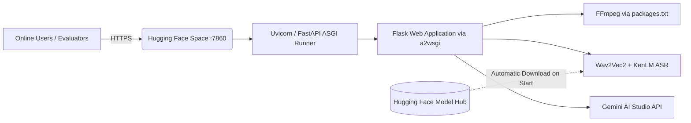

# 🌐 Deploying ClassScript to Hugging Face Spaces (Gradio SDK - 100% Free)

This guide provides step-by-step instructions for deploying the **ASR Lecture Transcriber & Study Assistant** to the public internet using **Hugging Face Spaces**.

> [!NOTE]
> Hugging Face has marked the "Docker" SDK as paid, but the **Gradio SDK is 100% FREE** (includes 2 vCPU, 16 GB RAM, 50 GB disk).
> We have set up an ASGI bridge (`a2wsgi`) in `app.py` and `packages.txt` for FFmpeg, so your entire Flask web application runs seamlessly on the **free Gradio tier** without needing a paid plan!

---

## 📋 Architecture Overview



1. **Model Weights** live in a Hugging Face **Model Hub** repository (free storage with fast CDN).
2. **Web Application & UI** lives in a free Hugging Face **Space (Gradio SDK)**.
3. On startup, system dependencies like FFmpeg are installed from `packages.txt`, and the model checkpoint is automatically downloaded from the Model Hub.

---

## 🛠️ Prerequisites

1. A free **Hugging Face account**: [Sign up here](https://huggingface.co/join).
2. A **Hugging Face Access Token** with **Write** permissions:
   - Go to [Hugging Face Settings → Tokens](https://huggingface.co/settings/tokens).
   - Click **Create new token**.
   - Select Type: **Write**.
   - Copy the token (starts with `hf_...`).
3. A **Google Gemini API Key**: [Get a free key from Google AI Studio](https://aistudio.google.com/apikey).

---

## 🚀 Step-by-Step Deployment Guide

### Step 1: Upload Your Local ASR Model to Hugging Face Model Hub

Your fine-tuned acoustic model and language model files (~1GB+) in `model_100k_clean_v2_1k_lm` need to be uploaded to Hugging Face once.

Open PowerShell or terminal in the project directory and run:

```bash
# Activate your virtual environment
.\venv_gpu\Scripts\activate   # (or venv\Scripts\activate)

# Upload the model (replace with your HF username and token)
python scripts/upload_model_to_hf.py --repo_id "YOUR_HF_USERNAME/asr-lecture-model" --token "hf_your_token_here"
```

> [!TIP]
> **Private Model**: If you do not want your model weights to be publicly downloadable by others, add the `--private` flag:
> ```bash
> python scripts/upload_model_to_hf.py --repo_id "YOUR_HF_USERNAME/asr-lecture-model" --private --token "hf_your_token_here"
> ```

---

### Step 2: Create a New Space on Hugging Face

1. Visit [https://huggingface.co/new-space](https://huggingface.co/new-space).
2. Fill in the details:
   - **Space name**: `classscript-transcriber` (or any name you like)
   - **License**: `mit` (or choose another)
   - **Space SDK**: Select **Gradio** → **Blank** (100% Free! Do not select Docker which has a Paid lock)
   - **Space hardware**: Select **CPU Basic (2 vCPU · 16 GB RAM) - Free**
   - **Visibility**: **Public** (or Private if you only want invited users)
3. Click **Create Space**.

---

### Step 3: Configure Space Secrets & Environment Variables

To allow your Space to access Gemini AI and your uploaded model:

1. In your newly created Space, navigate to the **Settings** tab.
2. Scroll down to **Variables and secrets**.
3. Under **Secrets**, click **New secret** and add:
   - **Name**: `GEMINI_API_KEY`
     - **Value**: Your Google Gemini API key
   - **Name**: `HF_MODEL_REPO_ID`
     - **Value**: `YOUR_HF_USERNAME/asr-lecture-model`
   - **Name**: `SECRET_KEY`
     - **Value**: Any random string (e.g. `classscript_secure_production_key_2026`)
4. *(Only if your model repository in Step 1 was set to Private)*:
   - Add another secret:
     - **Name**: `HF_TOKEN`
     - **Value**: Your Hugging Face token (`hf_...`)

---

### Step 4: Push the Application Code to Your Hugging Face Space

Your Hugging Face Space is a Git repository. Push this project code into it:

```bash
# 1. Add your Hugging Face Space as a git remote
git remote add space https://huggingface.co/spaces/YOUR_HF_USERNAME/classscript-transcriber

# 2. Stage your changes
git add .

# 3. Commit
git commit -m "Configure Hugging Face Space Docker deployment"

# 4. Push to Hugging Face
git push space main:main
```

*(If git asks for authentication, use your Hugging Face username and your HF Access Token as the password).*

---

### Step 5: Monitor Build and Launch

1. Go to your Space URL:
   `https://huggingface.co/spaces/YOUR_HF_USERNAME/classscript-transcriber`
2. Click on the **Logs** tab at the top right:
   - You will see Docker building the image, installing FFmpeg, and setting up dependencies.
   - Once the build succeeds, the container starts and downloads your ASR model from the Model Hub.
   - When startup completes, the status badge will change from **Building** to **Running**.
3. Your application is now live!

---

## 🔗 Direct URL & Embedding Options

Hugging Face provides two ways to share your app:

1. **Space Page**:
   `https://huggingface.co/spaces/YOUR_HF_USERNAME/classscript-transcriber`
   Displays the app inside the Hugging Face header/navigation.
2. **Direct Fullscreen App Link**:
   `https://YOUR_HF_USERNAME-classscript-transcriber.hf.space`
   Clean, standalone web link without any Hugging Face branding. Perfect for sharing directly with lecturers, evaluators, and test users!

---

## ⚡ Performance Tips for Final Year Project (FYP)

- **CPU vs GPU**: The free CPU tier works well and has 16GB of RAM. However, transcription on CPU runs at ~0.5x to 1.0x real-time (a 10-minute audio takes around 5–10 minutes).
- **1-Click T4 GPU Upgrade**: If you want real-time GPU transcription during your live FYP presentation or evaluation, you can temporarily switch the hardware in **Settings → Space Hardware** to **Nvidia T4 (small)** for ~$0.60/hour, run your live demo at lightning speed, and switch back to free CPU right after!
